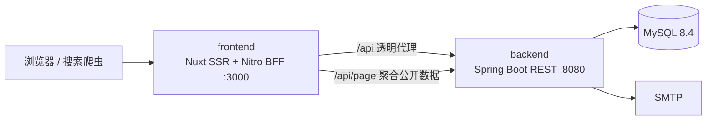

# 系统架构

## 服务边界

只有 frontend 映射站点宿主端口。backend 与 MySQL 不暴露公网：

- `edge`：frontend 与 backend；
- `data`：backend 与 MySQL，标记为 internal；
- `db-access`：仅 MySQL 使用，用于宿主机 `127.0.0.1:3307` 管理连接；
- frontend 只接收 `BACKEND_ORIGIN` 和 `SITE_URL`，不持有数据库、管理员、SMTP、TOTP 或访问指纹密钥。

## Nuxt 页面与组件

- `app/pages/` 使用 Nuxt 文件路由，公开首页兼容 `/`、`/index`、`/index.html`；
- `components/public/` 将 Header、Hero、经历、项目、AI Lab、联系、详情头、Markdown 和 Footer 拆成可复用组件；
- `components/admin/` 使用一个通用资源配置驱动经历、项目、笔记、AI 项目和联系方式 CRUD，统计、访问日志、留言、安全设置各自独立；
- `/admin/` 使用 `ClientOnly`，后台数据和 Bearer token 不进入 SSR HTML；
- 公共 SEO 仍由 SSR 输出，切换到 Vue 不会退化成纯 SPA。

## 页面请求

1. 浏览器请求 Nuxt 页面；
2. 页面在 SSR 阶段通过 `/api/page/**` BFF 聚合 Spring 公开 API；
3. 普通 GET 可记录一次访问，根 HEAD 不计访问且笔记 HEAD 不增加阅读量；
4. Nitro 返回完整 HTML、canonical、Open Graph、Twitter 和带 nonce 的 JSON-LD；
5. Vue hydration 复用 Nuxt payload，不重复请求页面 BFF；
6. 浏览器的留言和后台请求通过同源 `/api/**` 透明代理到 backend。

## BFF 与透明代理

- `/api/page/**` 只返回页面所需的稳定 DTO，并在服务端完成 Markdown 解析与清洗；
- `/api/[...path].ts` 保留 HTTP 方法、query、状态码和响应流，支持 GET/POST/PUT/DELETE/order；
- 代理请求体上限为 2 MiB，Markdown 预览上限为 100 KiB；
- 只透传 `content-type`、`cache-control`、`retry-after`、`x-robots-tag` 等响应头白名单；
- backend 5xx 在公开 BFF 中转换为不泄露内部信息的 503。

## 中英文双语

- 语言的权威信号是 URL 的 `/en` 前缀，SSR 与客户端一致，利于 SEO 与缓存；
- `nuxt.config.ts` 的 `pages:extend` 钩子为每个公开页面克隆一份 `/en` 前缀路由，指向同一组件，不复制页面文件、不改动取数逻辑；
- `app/composables/useLocale.ts` 依据当前路径判断语言，提供界面文案字典（`app/i18n/messages.ts`）、`localePath()` 和语言切换链接；
- 页面 BFF 请求携带 `x-site-lang`，经 `server/utils/request-context.ts` 转发给 backend 的 `X-Site-Lang` 头；
- backend 的 `SiteLang`（`common/SiteLang.java`）据此在公开 DTO 的 `from(entity, lang)` 映射里选择中文或英文字段，英文为空回退中文；`SiteService` 的缓存缓存实体数据（中英文都在内），语言选择发生在控制器层，不受缓存影响；
- 实体为每个展示文本字段新增了 `*_en` 列；slug、链接、状态、布尔等语言无关字段共用；
- 业务内容的中文是权威版本，英文为可选翻译，二者都在后台双份编辑。

## 真实 IP 信任链

Nitro 只信任 loopback、link-local 和 private 网络代理，并从 `X-Forwarded-For` 右向左停在第一个不可信地址。转发 backend 时丢弃原始代理链，重建最小 `X-Forwarded-*` 头。

Nuxt SSR 的内部 `$fetch` 没有 socket peer，因此根请求中间件先解析 IP、协议、Host、User-Agent、Referer 和方法，再通过私有 `x-homepage-*` 头传给页面 BFF。只有没有网络 peer 的 Nitro 内部子请求会接受这些头，外部调用不能用它们覆盖真实上下文。

生产拓扑应为：`公网反代/Nginx → frontend → backend`。backend 不应直接映射公网端口。

## 安全边界

- Vue 默认文本插值会转义业务内容；公开与后台 Markdown `v-html` 均只接收服务端白名单清洗后的 HTML；
- `nuxt-security` 为 SSR 内联脚本生成每请求 nonce，并设置 CSP、frame-ancestors、nosniff、Permissions-Policy 和 Referrer-Policy；
- `/admin` 精确 302 到 `/admin/`；所有后台页面和预览接口都设置 `no-store`、`noindex`；
- backend 对 `/api/admin/**` 统一验证 Bearer token，管理员失败登录按 IP 原子计数并锁定；
- token 只保存在当前标签页 `sessionStorage`，TOTP secret 只在 backend 加密存储；
- 完整 IP 与创建时离线解析的地区快照仅存入后台访问日志，admin API 受 Bearer token 和 no-store 保护；旧脱敏日志无法反推完整 IP。

## SEO、订阅和动态图片

- `/robots.txt`、`/sitemap.xml`、`/rss.xml`、`/feed.xml` 由 Nitro 动态生成；
- `/og/**.png` 使用容器内 Noto CJK 与 Resvg 生成 1200×630 PNG；
- OG 结果缓存一小时、最多 100 项，并按客户端 IP 限制为 30 次/分钟；
- 动态 OG 的 GET 与 HEAD 均显式声明，HEAD 计入限额但不查询后端或渲染图片。

## 数据持久化

Compose 项目名保持 `homepage`，MySQL 命名卷保持 `homepage_mysql-data`。Nuxt 迁移不改变 Spring API、数据库 schema 或卷名。

backend 使用 Hibernate `ddl-auto=update` 管理小规模 schema；`backend/src/main/resources/db/homepage-seed.sql` 保存新数据库的 Profile、经历、项目案例和联系方式默认值，由 `DataInitializer` 在 `profile.id=1` 不存在时执行。`db/content-updates/` 中的脚本只匹配上一版默认文案，用于幂等升级已有库；通过后台修改过的内容不会被覆盖。

正式演进到复杂结构迁移或多实例部署时，应将 schema 和版本化内容迁移统一交给 Flyway。
