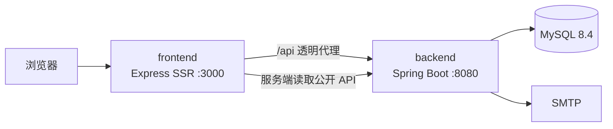

# 系统架构

## 服务边界

只有 frontend 映射宿主端口。backend 与 MySQL 仅在 Docker 网络中可见：

- `edge`：frontend 与 backend；
- `data`：backend 与 MySQL，标记为 internal；
- frontend 不持有数据库、管理员、SMTP、TOTP 或访问指纹密钥。

## 页面请求

1. 浏览器请求 frontend 页面；
2. frontend 使用 `/api/public/home` 获取白名单主页快照；
3. 普通 GET 再调用 `/api/public/visits` 记录访问，HEAD 不计数；
4. EJS 在服务端转义渲染 HTML；
5. 浏览器的留言和后台请求通过同源 `/api` 代理到 backend。

## 真实 IP 信任链

frontend 只信任 loopback、link-local 和 private 网络代理。转发 backend 时丢弃客户端原始转发头，并使用 Express 计算后的 `req.ip` 重建 `X-Forwarded-For`。backend 的 Tomcat native forwarded-header 处理再将可信 frontend 地址还原为 remote address。

生产拓扑应为：`公网反代/Nginx → frontend → backend`。backend 不应直接映射公网端口。

## 安全边界

- EJS 使用 `<%=` 转义业务内容；管理后台通过 `textContent` 创建用户数据节点；
- frontend 设置 CSP、frame-ancestors、nosniff 和 Referrer-Policy；
- backend 对 `/api/admin/**` 设置 no-store/noindex，并统一验证 Bearer token；
- 管理员失败登录按 IP 原子计数，达到阈值后固定时长锁定；
- IP 只以脱敏网段和独立盐值摘要记录。

## 数据持久化

Compose 项目名保持 `homepage`，MySQL 命名卷保持 `homepage_mysql-data`。前后端拆分不改变数据库 schema 或卷名。backend 目前使用 Hibernate `ddl-auto=update` 管理小规模 schema；正式演进到复杂迁移时应引入 Flyway。
